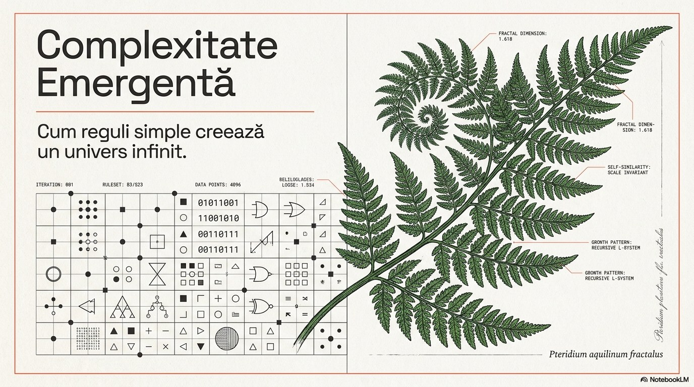
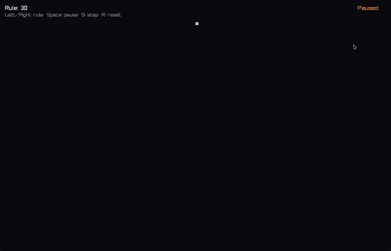
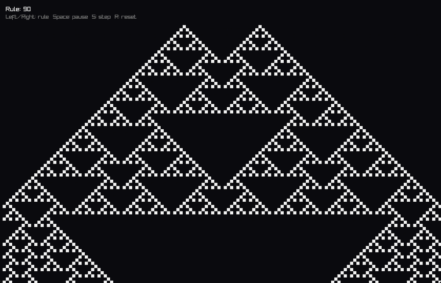
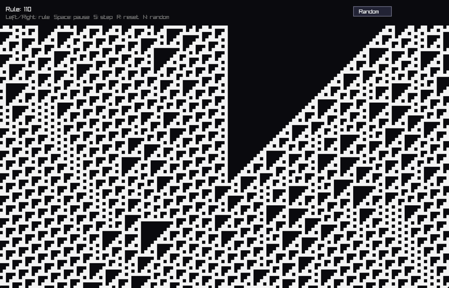
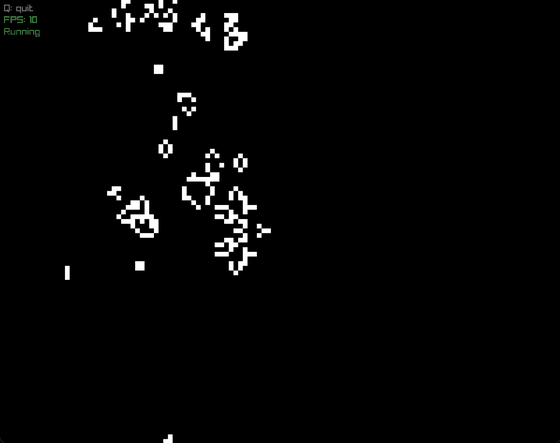
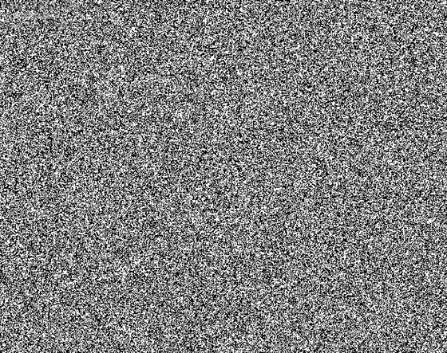
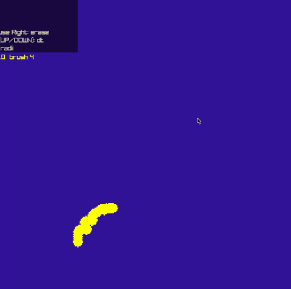
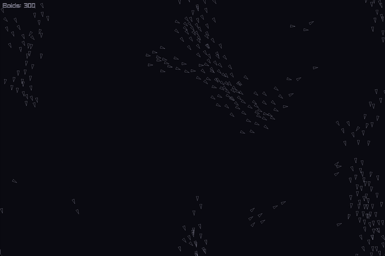

<div align="center">



# Emergent Complexity

**How simple rules create an infinite universe.**

Final course presentation for **CS112** at the
[Faculty of Mathematics and Computer Science, University of Bucharest](https://fmi.unibuc.ro/),
plus four C++ simulations, written from scratch, that were shown live during the talk.


[📑 Slides (PDF)](presentation/Complexitate_Emergenta.pdf) ·
[🎞️ Full deck with videos (.pptx, Releases)](../../releases/latest) ·
[🛠️ Build](#building)

</div>

---

> *"The essence of life is not so much the atoms and small molecules that go into us as the way,
> the ordering, the way those molecules are put together."* (Richard Dawkins)

**Emergence** is what happens when many simple parts follow simple local rules and together produce
behaviour that none of the parts has on its own. Examples are snowflakes from water molecules,
ant colonies from ants, and minds from neurons. The talk works through this idea with programs:
I wrote a small simulation for each concept and ran it live instead of showing static pictures.

The presentation itself is in **Romanian**; this README is in English.

## Contents

- [The simulations](#the-simulations)
  - [1. Elementary cellular automata](#1-elementary-cellular-automata)
  - [2. Life-like cellular automata (Game of Life & friends)](#2-life-like-cellular-automata-game-of-life--friends)
  - [3. SmoothLife](#3-smoothlife)
  - [4. Boids](#4-boids)
- [Building](#building)
- [What the talk covers](#what-the-talk-covers)
- [Repository layout](#repository-layout)
- [References](#references)

---

## The simulations

All four programs are written in **C++17** and use [**raylib**](https://www.raylib.com/) for the window and
drawing. CMake downloads raylib automatically, so you don't need to install anything except a compiler and CMake.

### 1. Elementary cellular automata

<p align="center">
  
  
  
  <br><sub><b>Rule 30</b> (chaos) · <b>Rule 90</b> (XOR → Sierpiński triangle) · <b>Rule 110</b> (Turing-complete)</sub>
</p>

A one-dimensional row of cells, each `0` or `1`. At every step a cell's new value depends only on
itself and its two neighbours. That gives 2³ = 8 possible neighbourhoods, so a rule is just an 8-bit number
([Wolfram code](https://en.wikipedia.org/wiki/Wolfram_code)). The whole update fits in one line:

```cpp
int index = (left << 2) | (center << 1) | right;   // 0b000 .. 0b111
next[x]   = (rule >> index) & 1;                   // look the bit up in the rule number
```

All 256 rules can be explored live. Each new row is drawn below the previous one, so the screen shows
the automaton's history over time. The edges wrap around.

| Key | Action |
|---|---|
| `←` / `→` | Previous / next rule (0–255) |
| `Space` | Pause / resume |
| `S` | Single step |
| `R` | Reset to a single black cell in the middle |
| `N` or **Random** button | Start from a random row |

Source: [`elementary_ca/src/main.cpp`](elementary_ca/src/main.cpp). The starting rule is set by `#define RULE 30`.

---

### 2. Life-like cellular automata (Game of Life & friends)

<p align="center">
  
  
  <br><sub>Gliders, oscillators and still lifes (left) · random noise organising into caves, as used in procedural generation (right)</sub>
</p>

A 2D grid with the Moore neighbourhood (8 neighbours) on a torus. Rules are written in **B/S notation**:
a dead cell is **B**orn if its live-neighbour count is in the birth set, and a live cell **S**urvives if
its count is in the survival set. Both sets are plain `unordered_set<int>`, so switching between
Conway's Life and other variants means changing two lines:

```cpp
unordered_set<int> reproductionSet = {3,6,7,8};    // B3678
unordered_set<int> survivalSet     = {3,4,6,7,8};  // S34678 → "Day & Night"
// Conway's Game of Life would be: {3} and {2,3}
```

The source includes a comment block with about 30 rule presets: HighLife, Maze, Coral, Seeds, Amoeba, Replicator,
Diamoeba, Walled Cities and more.

The program runs in two phases:

**1. Setup (draw the initial state)**

| Key | Action |
|---|---|
| Left mouse | Paint cells |
| `A` | Toggle brush mode (paint square clusters instead of single cells) |
| Arrow keys | Grow / shrink the brush |
| `R` | Fill the grid with uniform random noise |
| `T` | Scatter random clustered blobs |
| `L` | Place a solid rectangle |
| `Q` | **Start the simulation** |

**2. Simulation**

| Key | Action |
|---|---|
| `Space` | Pause / resume |
| `Q` / `Esc` | Quit |

Source: [`game_of_life/src/main.cpp`](game_of_life/src/main.cpp)

---

### 3. SmoothLife

<p align="center">
  
</p>

A **continuous** generalisation of the Game of Life, after
[Stephan Rafler (2011)](https://arxiv.org/abs/1111.1567). Cell states are real numbers in `[0, 1]`, and the
neighbourhood is a disc plus a surrounding ring instead of the 8 adjacent cells. Each step:

1. **Inner filling `m`**: weighted average over a disc of radius `r_i = 8/3`.
2. **Outer filling `n`**: weighted average over the ring `r_i < d < r_o = 8`.
3. A smooth transition function `s(n, m)`, built from logistic sigmoids, replaces the hard
   "born / survive" thresholds.
4. Cells are updated with a small time step: `f ← clamp(f + dt · (2·s(n, m) − 1), 0, 1)`.

The kernel edges are anti-aliased with `smoothstep`, and the wrapped neighbour indices are precomputed once
per kernel, so the inner loop is just multiply-adds. The engine (`SmoothLifeEngine`) is kept separate
from the raylib front end.

| Key | Action |
|---|---|
| `Space` | Pause / resume |
| `R` / `C` | Randomize / clear |
| Left / right mouse | Add / erase mass |
| Mouse wheel | Brush size |
| `↑` / `↓` | Increase / decrease time step `dt` |
| `[` / `]` | Shrink / grow the neighbourhood radii |

Source: [`smooth_life/src/`](smooth_life/src). Parameters are in `SmoothLifeSettings` in
[`SmoothLifeEngine.hpp`](smooth_life/src/SmoothLifeEngine.hpp).

---

### 4. Boids

<p align="center">
  
</p>

[Craig Reynolds' 1986](https://www.red3d.com/cwr/boids/) model of flocking birds and schooling fish. No boid
knows the shape of the flock. Each of the 300 agents only reacts to the neighbours it can **see**
(within a 240° field of view) using three local steering rules:

| Rule | What it does | Radius | Weight |
|---|---|---|---|
| **Separation** | Steer away from neighbours that are too close | 28 px | 1.5 |
| **Alignment** | Match the average heading of neighbours | 55 px | 1.0 |
| **Cohesion** | Steer towards the neighbours' centre of mass | 65 px | 1.0 |
| *Wander* | Small random drift so the flock doesn't settle | — | 0.3 |

Each rule produces a *desired* velocity, and the steering force is `desired − velocity`, clamped to the boid's
`maxForce`. Every boid has a slightly different max speed and max force, which makes the flock look less
mechanical. The screen wraps around at the edges. Press `Esc` to quit.

Source: [`boids/src/main.cpp`](boids/src/main.cpp)

---

## Building

**Requirements:** a C++17 compiler (Clang, GCC or MSVC), CMake ≥ 3.16 and Git. raylib 5.5 is downloaded
automatically at configure time. On Linux you also need the usual X11/OpenGL dev packages that raylib requires
([list](https://github.com/raysan5/raylib/wiki/Working-on-GNU-Linux)).

**Build everything at once:**

```bash
git clone https://github.com/edwarderzegovina/emergent-complexity.git
cd emergent-complexity
cmake -B build -DCMAKE_BUILD_TYPE=Release
cmake --build build -j
```

**Run:**

```bash
./build/elementary_ca/elementary_ca
./build/game_of_life/game_of_life
./build/smooth_life/smooth_life
./build/boids/boids
```

Each folder is also a standalone CMake project, so you can build just one, for example
`cmake -S boids -B boids/build && cmake --build boids/build`.

> **Tip:** build in `Release` mode. SmoothLife does a full convolution every frame and is noticeably slower in Debug.

---

## What the talk covers

The [slides](presentation/Complexitate_Emergenta.pdf) (28 in total) follow this outline. Slide titles are translated from Romanian.

1. **What is emergence?** Simple elements plus simple rules produce complexity greater than the sum of the parts.
   Examples: water and snowflakes, ant colonies and the brain, chess strategy.
2. **Combinatorial explosion.** `n` bits give `2ⁿ` states. This exponential growth is the "engine" that lets a
   system produce far more information than was put into it.
3. **Elementary cellular automata.** State, neighbourhood and transition function; Wolfram codes.
   Live demos of Rule 2, **Rule 90** (literally an XOR of the two neighbours, which draws the Sierpiński triangle),
   **Rule 30** and **Rule 110**.
4. **Iteration creates complexity.** The Game of Life and Rule 110 are **Turing-complete**.
5. **Wolfram's four classes:** (1) homogeneous, (2) periodic, (3) chaotic, (4) complex, a mix of order and chaos where life-like
   behaviour happens. ([*A New Kind of Science*, p. 231](https://www.wolframscience.com/nks/p231--four-classes-of-behavior/))
6. **Emergent simplicity.** A ball is, in a sense, *simpler* than one of its atoms: a few numbers predict its
   motion. Stable local structures such as gliders are typical of Class 4.
7. **Chaos and computational irreducibility.** Can you know Rule 30's centre column at step 100 without simulating it?
   (See the [Rule 30 Prize](https://rule30prize.org/).) Sensitivity to initial conditions, error amplification,
   and the link to the Halting Problem, with a live Game of Life butterfly-effect demo.
8. **Procedural generation.** Turning random noise (Class 3) into stable, organic caves (Class 2) with
   B45/S45678-style smoothing rules, as used in games like *Terraria* and *Minecraft*.
9. **Boids and SmoothLife.** Flocking from three linear steering rules; continuous cellular automata.
10. **Conclusion.** I never programmed the shape of the flock, only three local rules. No formula can say where a
    given bird will be at step one million. The only way to find out is to run the algorithm.

The PDF has static slides only. The original `.pptx` with all the embedded screen recordings is about 275 MB,
too large for a Git repository, so it is attached to the
[**latest release**](../../releases/latest).

---

## Repository layout

```
emergent-complexity/
├── CMakeLists.txt              # top-level build: all four programs
├── elementary_ca/              # 1D Wolfram automata (all 256 rules)
│   └── src/main.cpp
├── game_of_life/               # 2D life-like automata, configurable B/S rules
│   └── src/main.cpp
├── smooth_life/                # continuous Game of Life (Rafler 2011)
│   └── src/
│       ├── SmoothLifeEngine.hpp
│       ├── SmoothLifeEngine.cpp
│       └── main.cpp
├── boids/                      # Reynolds flocking
│   └── src/main.cpp
├── presentation/
│   └── Complexitate_Emergenta.pdf
└── docs/media/                 # GIFs and screenshots used in this README
```

---

## References

- Stephen Wolfram, [*A New Kind of Science*](https://www.wolframscience.com/nks/) (2002)
- Martin Gardner, "The fantastic combinations of John Conway's new solitaire game 'life'", *Scientific American* (1970)
- Craig W. Reynolds, ["Flocks, Herds, and Schools: A Distributed Behavioral Model"](https://www.red3d.com/cwr/papers/1987/boids.html), SIGGRAPH (1987)
- Stephan Rafler, ["Generalization of Conway's 'Game of Life' to a continuous domain – SmoothLife"](https://arxiv.org/abs/1111.1567) (2011)
- Matthew Cook, "Universality in Elementary Cellular Automata", *Complex Systems* 15 (2004)
- [The Rule 30 Prizes](https://rule30prize.org/)
- [raylib](https://www.raylib.com/), a simple and easy-to-use library for videogames programming

---

<div align="center">

Made by **Axante Edward-Ioan** · Faculty of Mathematics and Computer Science, University of Bucharest

Released under the [MIT License](LICENSE).

</div>
